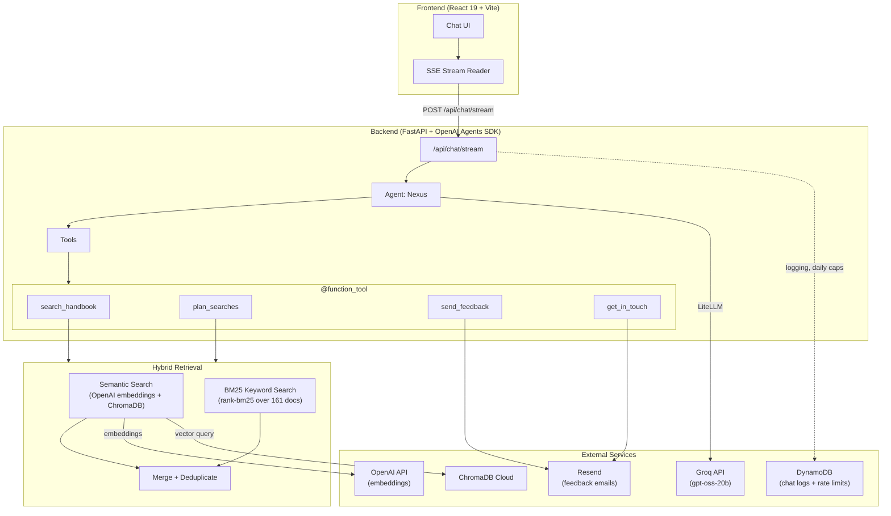
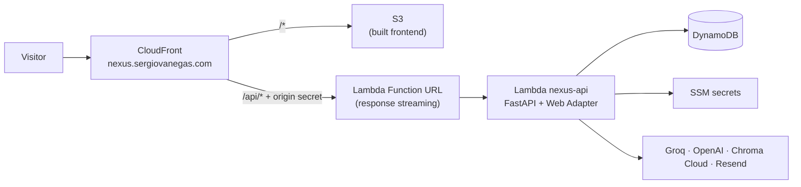

# Nexus — Agentic RAG Chatbot for the Made Tech Handbook

**Live:** https://nexus.sergiovanegas.com

An agentic RAG chatbot that helps employees find answers across 161 company handbook documents using hybrid search (semantic + keyword), multi-step planning, and real-time tool transparency.

> **Why this exists:** Nobody reads HR policies until they need a quick answer. The usual path — searching folders, emailing HR, asking colleagues — is slow and often outdated. Nexus gives employees 24/7 access to grounded, conversational answers referenced in official documents.

## Key Features

- **Agentic architecture** — OpenAI Agents SDK with `@function_tool` decorators. The LLM autonomously decides when to search, plan multi-step queries, or answer directly.
- **Hybrid search** — Combines semantic search (OpenAI embeddings + ChromaDB) with BM25 keyword search for exact term matching (ISO 27001, BPSS, etc.).
- **Multi-step planning** — `plan_searches` tool executes multiple handbook searches at once for comparison questions, with cross-search deduplication.
- **Real-time transparency** — SSE streaming shows each tool step as it happens (live checklist with progress indicators).
- **Smart routing** — Structural questions ("What roles exist?") answered from the system prompt. Follow-ups resolved via tool-call query rewriting. Greetings handled without search.
- **Input guardrails** — English-only, Made Tech-related, with polite redirects for off-topic or gibberish input.
- **Feedback & contact tools** — Users can send feedback or contact the creator through natural conversation.

## Architecture



### Request Flow

```
User sends message
  → Frontend POST /api/chat/stream (SSE)
  → Agent "Nexus" receives question + history
  → LLM decides: answer directly OR call tools
    ├─ Simple question → search_handbook (1 search)
    ├─ Complex/comparison → plan_searches (2-3 searches at once)
    ├─ Structural ("what roles exist?") → answer from system prompt
    ├─ Greeting → direct response, no tools
    └─ Feedback/contact → collect info, then send_feedback or get_in_touch
  → Each tool step streamed to frontend as SSE event
  → Final answer + sources streamed as "done" event
  → Frontend renders checklist → answer → sources
```

## Prerequisites

- **Local development**: Python 3.12, Node.js 22, [uv](https://docs.astral.sh/uv/)
- **Container**: Docker only
- **Deploying**: Terraform 1.10+, AWS CLI, Git Bash on Windows

## Quick Start

### 1. Backend

Create `backend/.env` (see [Environment Variables](#environment-variables)), then:

```bash
cd backend
uv sync
uv run uvicorn src.app:app --reload --port 9481
```

### 2. Frontend (separate terminal)

```bash
cd frontend
npm install
npm run dev
```

Open http://localhost:3000 (Vite proxies `/api` to the backend).

### 3. Container

The same image that runs on Lambda, without the Lambda adapter (API only; the frontend is
served separately):

```bash
docker build --target app -t nexus-api backend
docker run -p 9481:8080 --env-file backend/.env nexus-api
```

### 4. Tests

```bash
cd backend && uv run ruff check . && uv run pytest -q   # offline: fake RAG service, moto DynamoDB
cd frontend && npm test && npm run build
```

## Deployment (AWS, serverless)



- **Infrastructure as code:** Terraform in [`infra/`](infra/) (state in S3, us-east-1).
- **Streaming:** the Function URL runs in `RESPONSE_STREAM` mode, so each agent tool step reaches
  the browser as it happens.
- **CI** ([`ci.yml`](.github/workflows/ci.yml)), on every PR and push: ruff + pytest, vitest +
  type-checked build, Docker build, gitleaks secret scan, Terraform fmt/validate.
- **Infra plan on PRs:** a read-only role runs `terraform plan`, so infrastructure changes are
  visible before merging.
- **CD** ([`deploy.yml`](.github/workflows/deploy.yml)): every merge to `main` that passes CI deploys
  everything with no manual steps: builds the image, `terraform apply` (infrastructure and the new
  Lambda image), uploads the frontend and smoke-tests `/api/health`, using GitHub OIDC (no AWS
  keys stored in GitHub).
- **Cost guards:** reserved concurrency, per-visitor and global daily caps in DynamoDB, CloudWatch
  alarms by email. Idle cost is close to zero: nothing runs between requests.

Runbook and first-time setup: [AGENTS.md](AGENTS.md#5-aws-deployment).

## Environment Variables

Create `backend/.env` (see `backend/.env.example`):

| Variable | Purpose | Required |
|----------|---------|----------|
| `GROQ_API_KEY` | Primary LLM (Groq) | Yes |
| `OPENAI_API_KEY` | Embeddings + fallback LLM | Yes |
| `CHROMA_API_KEY` | ChromaDB Cloud | Yes |
| `TENANT_CHROMA` | ChromaDB Cloud tenant | Yes |
| `RESEND_API_KEY` | Email service (feedback/contact) | No |
| `CONTACT_EMAIL` | Feedback destination email | No |
| `TABLE_NAME` | DynamoDB table for chat logs + daily caps (set by Terraform on AWS) | No |

On AWS the keys come from SSM Parameter Store (`/nexus/`), set with `scripts/set_aws_secrets.py`.

## Configuration

RAG behavior is controlled by `backend/config.yaml`:

```yaml
model: "groq/openai/gpt-oss-20b"
retrieval:
  retrieval_k: 10
  final_k: 10
approach:
  use_query_rewriting: false    # Redundant — orchestrator rewrites via tool calls
  use_reranking: false          # Basic RAG won in experiments
  use_keyword_search: true      # BM25 hybrid search
```

## Project Structure

```
madetech-rag-assistant/
├── backend/
│   ├── config.yaml              # RAG pipeline configuration
│   ├── src/
│   │   ├── app.py               # FastAPI routes + SSE streaming
│   │   ├── rag_service.py       # RAG orchestration
│   │   ├── rag/
│   │   │   ├── agent_pipeline.py    # OpenAI Agents SDK pipeline
│   │   │   ├── pipeline.py          # Legacy pipeline (experiments)
│   │   │   ├── retrieval.py         # ChromaDB semantic search
│   │   │   └── keyword_search.py    # BM25 keyword search
│   │   ├── chat_logger.py       # DynamoDB chat logs
│   │   ├── ratelimit.py         # Daily caps (DynamoDB counters)
│   │   ├── ssm.py               # Secrets from SSM at cold start
│   │   └── contact_service.py   # Resend email
│   ├── utils/
│   │   ├── models.py            # Pydantic models
│   │   └── prompts.py           # System prompts
│   ├── data/handbook/           # 161 markdown source files
│   ├── tests/                   # pytest (offline)
│   └── Dockerfile               # app + lambda stages
├── frontend/
│   ├── App.tsx                  # Root component + state management
│   ├── components/
│   │   ├── ChatArea.tsx         # Messages, input, live tool steps
│   │   ├── MarkdownRenderer.tsx # Themed markdown rendering
│   │   ├── SourceViewer.tsx     # Document inspection panel
│   │   └── WelcomeModal.tsx     # Onboarding modal
│   └── services/
│       ├── apiService.ts        # SSE + REST API client
│       └── sse.ts               # Chunk-safe SSE parser
├── experiments/                 # Evaluation framework
│   ├── notebooks/               # Jupyter analysis notebooks
│   └── scripts/                 # Automated experiment runners
├── infra/                       # Terraform (AWS)
├── scripts/                     # deploy.sh, upload_frontend.sh, set_aws_secrets.py
└── .github/                     # CI, deploy, Dependabot
```

## Experiments

The `experiments/` directory contains a full evaluation framework for benchmarking RAG configurations, models, and retrieval strategies. See [`experiments/README.md`](experiments/README.md) for details.

Key findings:
- **Best configuration**: Basic RAG with `groq/openai/gpt-oss-20b` (no rewriting, no reranking)
- **Query rewriting confirmed redundant**: The orchestrator LLM already rewrites queries via tool calls
- **Latency and failure tracking**: Mean/p50/p95 latency + RAG/judge error rates per experiment

## License

MIT

## Author

Built by [Sergio Vanegas](https://www.linkedin.com/in/sergio-vanegas/) — [View source code](https://github.com/smvanegasp/madetech-rag-assistant)
